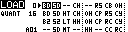
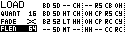
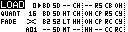
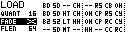
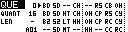

# Load Page

The Load Page loads grid slots into the active tracks or destination slots.

Open it from the Grid Page with:

```text
[Yes/Enter]
```

On MegaCommand and MegaCMD, **`Load | Yes`** opens it too.



On MegaCommand, MegaCMD and TBD, Load opens on the Grid Page itself. The left column becomes the Load panel and the grid stays visible, with the selected slots inverted and an arrow beside the row they load from.

| Line | Shows |
| --- | --- |
| 1 | The load mode in a box: `LOAD` (Manual), `AUTO` or `QUE`. Beside it, a 16th-step count for timing a load against the `QUANT` point. |
| 2 | `QUANT`. |
| 3 | In Queue mode, `LEN`. In the other modes, `FADE` and its mode while the fade is on. |
| 4 | The row the trigs load from, for example `A01`. |

A slot that is waiting to load has a moving outline until it loads.

Whether Load closes after a load is set by `CONFIG > SYSTEM > LOAD/SAVE` (see The LOAD/SAVE System Setting below).

## Load Behavior

Loading a slot can restore:

- sequence data
- sound or device state, if `SOUND` is enabled for the slot
- length, loop and jump settings
- page-specific state for performance, route, auxiliary and tempo groups

Use the Slot Menu `SOUND` option to make a slot load sequence-only.

## Controls

| Control | Assignment |
| --- | --- |
| **[Trig]** keys | Select slots. Releasing the trigs loads them. |
| **[Scale]**, **`Page`** | Toggle Grid X / Grid Y while selecting. |
| **[Bank A/B/C]** | Set the load mode: Manual, Auto or Queue. Hold to also edit the Load panel with the cursor on `QUANT`. |
| **[Bank D]** (the Slide key) | Tap to turn `FADE` off or on (not in Queue mode). Hold to edit the Load panel with the cursor on `FADE` (see Fade). |
| **[Function]** | In Manual mode, open `DEST` to choose a destination (see Destination). |
| **[Yes/Enter]**, **`Shift | Menu`** | Hold for group selection; release to load the selected groups. |
| **[Global]**, **`Load | Yes`** | Hold to edit the Load panel (see Editing The Load Panel). |
| **[No/Exit]**, **`Save | No`**, a tap of **`Load | Yes`** | Close Load. |
| **[Play]**, **[Stop]** | Start and stop the sequencer. Load stays open. |
| **[Rec]**, **[Classic/Extended]** | Open the Step Editor, or the Mixer Page while the sequencer plays. Load opens again when you return to the Grid Page. |
| Other keys | Close Load and do their usual job. |

The encoders and arrow keys depend on the `LOAD/SAVE` system setting.

## The LOAD/SAVE System Setting

`CONFIG > SYSTEM > LOAD/SAVE` chooses how the encoders and arrow keys work while Load is open, and whether Load closes after a load.

| Setting | Encoders | **[Up/Down]**, **[Left/Right]** | After a load |
| --- | --- | --- | --- |
| `LEGACY` (after an upgrade) | Encoder 1 sets the load mode, Encoder 2 `LEN` (Queue mode) and Encoders 3 and 4 `QUANT`. | Close Load and move the Grid Page cursor. | Load closes. |
| `CLOSE` | Navigate the grid, as on the Grid Page. | Navigate the grid: **[Up/Down]** move to another row; **[Left/Right]** scroll the columns shown. Load stays open. | Load closes. |
| `STAY` (default) | Navigate the grid, as on the Grid Page. | Navigate the grid: **[Up/Down]** move to another row; **[Left/Right]** scroll the columns shown. Load stays open. | Load stays open, ready for the next load. |

A new install starts on `STAY`. When MCL 5.10 is installed over MCL 5.00 to 5.02, the setting starts on `LEGACY`, so the encoders and arrow keys work as before.

## Editing The Load Panel

Hold **`Load | Yes`**, or **[Global]** on the Machinedrum, to edit the values on the Load panel. Holding **[Bank A]**, **[Bank B]** or **[Bank C]** sets the load mode and opens the same edit with the cursor on `QUANT`. Holding **[Bank D]** opens it with the cursor on `FADE` (see Fade).



While it is held, a cursor moves over the values:

| Load mode | Values, top to bottom |
| --- | --- |
| Manual, Auto | The load mode (the box at the top), `QUANT`, `FADE` and, while the fade is on, `FLEN`. |
| Queue | The load mode, `QUANT` and `LEN`. |

- Encoder 2 or **[Up/Down]** move the cursor. The value under it is inverted.
- Encoder 1 or **[Left/Right]** change it.
- On the load mode or `QUANT`, **[Trig]** 1 to 6 set `QUANT` to 2 to 64 steps, doubling with each trig; the trigs above set 64. The trig for the current value is lit.
- On `LEN`, **[Trig]** 1 to 6 set `LEN` to 2 to 64 steps the same way. Press the lit trig again to set `LEN` back to `-`.
- On `FADE` or `FLEN`, the trigs set the fade length (see Fade).

While the panel is edited, the step count and the row are hidden.

When it is released, the encoders go back to their usual job.

## Fade

`FADE` fades the level of Machinedrum tracks when their slots load, in Manual and Auto mode. Queue loads do not fade.

### Turning It On

Tap **[Bank D]** (the Slide key) to turn `FADE` on or off. It turns on in the mode it had last, or `MIX` the first time. In Queue mode, where the panel shows `LEN` and not `FADE`, a tap does nothing: hold **[Bank D]** to see and change the fade.



While the fade is on, line 3 shows `FADE` and a small graphic of its mode:

| Fade mode | Graphic | Result |
| --- | --- | --- |
| `MIX` | A cross | The direction depends on what the track is playing (see below). |
| `OUT` | A filled falling ramp | Every loaded track fades out. |
| `IN` | A filled rising ramp | Every loaded track fades in. |

While the fade is off, line 3 is blank. It shows `FADE -` while the Load panel is edited.

### Setting The Fade

Hold **[Bank D]** to set the fade. The Load panel's edit opens, as with **`Load | Yes`** or **[Global]**, with the cursor on `FADE`.



- **[Left/Right]** or Encoder 1 change the row under the cursor. **[Up/Down]** or Encoder 2 move the cursor to `FLEN`, or to the other rows.
- `FADE` steps through `-` (off), `MIX`, `OUT` and `IN`.
- `FLEN` steps through `-` and 1 to 256 steps.
- **[Trig]** 1 to 8 set `FLEN` to 2 to 256 steps, doubling with each trig, and turn the fade on. **[Trig]** 9 to 16 also set 256. The trig for the current length is lit; press it again to set `FLEN` back to `-`.

In Queue mode, where line 3 is `LEN`, `FADE` and `FLEN` take its place for as long as **[Bank D]** is held.

Release **[Bank D]** to close the edit.

### Length

A fade lasts `FLEN` steps. With `FLEN` at `-`, it lasts the `QUANT` length, or the slot's own length when `QUANT` is also `-`.

### Fade Mode MIX

In fade mode `MIX`, when a slot loads, the fade direction is determined automatically by what its track is playing:

| The track was | You load | Result |
| --- | --- | --- |
| Playing | A different slot | The playing slot fades out. The new slot switches in one fade length after the load point, then fades in. |
| Playing | The slot it is playing | The track fades out and stays silent. |
| Silent after a fade out, or not loaded yet | Any slot | The slot switches in and fades in. |

### Notes

- A load made while the sequencer is stopped fades when **[Play]** is pressed. A track that will fade in is silent until then.
- A track that a fade left silent gets its level back the next time a slot loads on it.
- A fade does not change the track's saved `LEV`.

## Loading Individual Slots

1. Open Load.
2. Select one or more slots with the **[Trig]** keys.
3. Release the trigs. The slots load according to the load mode.

The visible grid determines which grid the trig keys target. Use **[Scale]** to switch grids while building a selection.

## Group Load

Hold **[Yes/Enter]**, or **`Shift | Menu`**, from Load to open group selection.


| Group | Loads |
| --- | --- |
| 1 | Primary device group. |
| 2 | Secondary device group. |
| 3 | Performance state group. |
| 4 | Auxiliary or route state group. |
| 5 | Tempo/clock state group. |

Use **[Trig 1-5]** to toggle the groups, then release **[Yes/Enter]** or **`Shift | Menu`** to load them from the current row.

Group selection is also used by bank/trig row loading and program-change row loading.

## Load Modes

| Mode | Behavior |
| --- | --- |
| `MAN` | Load the selected slots at the next transition point. Existing queues for those slots are cleared. |
| `AUT` | Load the selected slots, then follow each slot's `LOOP` and `JUMP` settings when its loop count is reached. |
| `QUE` | Add the selected row or slot to that column's queue. Queued entries repeat in order. |



A `MAN` or `AUT` load on a column that is chaining waits for the chain: the chain keeps going until it would next move at or after the load's `QUANT` point, and the load goes in there. With `QUANT` at `-`, or with a destination, the load does not wait.

Each slot/column has its own chain state. One track can follow an automatic chain while another plays a queued set of rows and another stays where it is.

## Queue Length Override

In Queue mode, `LEN` sets a length override.

| Value | Behavior |
| --- | --- |
| `-` | Use the queued slot's stored length. |
| 2-64 | Override the queued length in steps. |

Turning the encoder that sets `LEN` steps through powers of two. Hold the encoder's button while turning for the values in between, such as `3`, `5` or `6`. While the Load panel is edited, the trigs set `LEN` too (see Editing The Load Panel).

This is useful when a short track should loop for a longer phrase, or when a group of slots should advance together despite having different stored lengths.

## Quantization

`QUANT` sets the transition point for the load.

| Value | Meaning |
| --- | --- |
| `-` | Load at the destination track's next transition point, based on its current length and speed. |
| 2-64 | Load at the next matching step interval. |

Turning the encoder that sets `QUANT` steps through powers of two. Hold the encoder's button while turning for the values in between.

Use quantization to keep manual, auto and queue loads aligned with the phrase length.

## Destination

In Manual mode, a selection can load into other slots than its own. Pick the destination first, then the source.


1. Press **[Function]**. Line 2 shows `DEST`.
2. Press the **[Trig]** for the destination slot; press **[Scale]** first for a slot on the other grid. Line 4 shows the slot as grid and column in front of the row, for example `X:05 A01` (`X:--` until a trig is pressed).
3. Release the trig. This ends the choice: line 2 shows `QUANT` again, and the destination (`X:05`) stays on line 4 to show where the next load goes.
4. Select the source slots (**[Scale]** again if they are on the other grid) and release them. The first selected slot loads into the destination and the rest follow in order.

Press **[Function]** again to close `DEST` without choosing; pressing it twice clears a destination already chosen. The destination is used by the next load, then cleared. Closing Load clears it too.

A range that runs past the last column of Grid X continues on Grid Y; slots that would land past the last column of Grid Y are not loaded.

The destination applies only in Manual mode: **[Function]** does nothing in Auto and Queue, and loads in those modes ignore a destination picked earlier.

## Bank And Trig Row Loading

From the Grid Page, **[Bank]** + **[Trig]** loads rows by bank position.

| Gesture | Result |
| --- | --- |
| First row selected | Jump to or load that row. It uses Auto only if Auto was already active; otherwise it uses Manual. |
| Additional rows selected | Queue the selected rows as a row chain. |

After the row selection is applied, MCL restores the load mode that was active before the bank/trig gesture.

A row load waits for a chaining column in the same way as a Manual or Auto load. Columns outside the selected groups keep chaining.

## Track Levels During Load

When a slot loads while the sequencer is running, MCL does not send the track's `LEV` to the Machinedrum. Loads keep the mix levels as they are, and `LEV` stays free for fading tracks in and out by hand.

Set each track's relative loudness with its `VOL` parameter instead. With `CONFIG > MACHINEDRUM > NORMALIZE` at `AUTO`, MCL does this when tracks are saved: it raises `LEV` to 127 and lowers `VOL` and its locks to keep the same loudness, so `LEV` at 127 is always the track's full level.

`FADE` is the exception: it moves the level of each loading track itself (see Fade).
