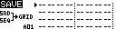

# Save Page

The Save Page writes the current track or group state into grid slots.

Open it from the Grid Page with:

```text
[Function] + [Yes/Enter]
```

On MegaCommand and MegaCMD, **`Save | No`** opens it too.



On MegaCommand, MegaCMD and TBD, Save opens on the Grid Page itself. The left column shows `SAVE` and what is saved (`SND` and `SEQ` into the grid), with the row on line 4 and an arrow beside the row in the grid.

Save closes after a save. With `CONFIG > SYSTEM > LOAD/SAVE` set to `STAY`, it stays open for the next save.

## Stored Data

Save stores sequence data and any supported sound or state data for the selected slots.

| Source | Typical saved data |
| --- | --- |
| Device tracks | Sequence data, sound/device state, locks, length and link settings. |
| Performance group | Performance controller and state data. |
| Auxiliary/route group | Route or page-specific auxiliary state. |
| Tempo group | Tempo/clock-related state. |

The actual saved data depends on the selected device and slot type.

## Controls

| Control | Assignment |
| --- | --- |
| **[Trig]** keys | Select the slots to save. Releasing the trigs saves them. |
| **[Scale]**, **`Page`** | Toggle Grid X / Grid Y while selecting. |
| **[Yes/Enter]**, **`Shift | Menu`** | Hold to open group selection; release to save the selected groups. |
| **[No/Exit]**, **`Save | No`**, **`Load | Yes`** | Close Save. |
| **[Up/Down]**, **[Left/Right]** | With `LOAD/SAVE` at `STAY`, **[Up/Down]** move to another row and **[Left/Right]** scroll the columns shown. Otherwise they close Save and move the Grid Page cursor. |
| **[Rec]**, **[Classic/Extended]** | Open the Step Editor, or the Mixer Page while the sequencer plays. Save opens again when you return to the Grid Page. |
| Other keys, including **[Play]** and **[Stop]** | Close Save and do their usual job. |

## Saving Individual Slots

1. Open Save.
2. Select one or more slots with the **[Trig]** keys.
3. Release the selection to save the corresponding tracks to the current row.

The visible grid determines whether the trig keys target Grid X or Grid Y. Use **[Scale]** to switch grids while building a selection.

## Saving Across Both Grids

To save tracks from both grids in one operation:

1. Open Save.
2. Select slots on the first grid.
3. Use **[Scale]** to switch to the other grid.
4. Select additional slots.
5. Release the selection to save all selected slots.

## Group Save

Hold **[Yes/Enter]**, or **`Shift | Menu`**, from Save to open group selection.


The group selector uses the first five trig keys.

| Group | Saves |
| --- | --- |
| 1 | Primary device group. |
| 2 | Secondary device group. |
| 3 | Performance state group. |
| 4 | Auxiliary or route state group. |
| 5 | Tempo/clock state group. |

Use **[Trig 1-5]** to toggle the groups, then release **[Yes/Enter]** or **`Shift | Menu`** to save them.

The group icons follow the configured devices. A classic Machinedrum project may show MD-related groups; a TBD or generic MIDI project may show different device icons.

## Row Names

When a group or row-level save writes active slot data, the row name is associated with the row and shared across grids. Rename rows from the Slot Menu.

## Saving And Projects

Saving slots updates the current project's grid files. A separate full-project save is not required after writing the relevant slots.

Supported project configuration is stored in the project header when system configuration is written. `CONFIG > SYSTEM > PROJ CFG` controls whether those stored settings are applied when the project loads. The Machinedrum `SAMPLEBANK` link is part of project configuration and loads with the project.
