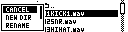

# Sound Manager Page

The Sound Manager saves and loads Machinedrum sound presets. It is separate from the Sample Manager: sounds store machine setup and parameters, while samples store audio data.

Open it from a Machinedrum step track:

**[Global] > SOUND**

## Sound Contents

A sound preset stores the active Machinedrum track's machine assignment and parameters. If the track uses a Trig Group to trigger another track, the linked track's machine settings are stored with it so the pair can be recalled together.

Sound files use the `.snd` extension and are stored in the logical folder:

`/Sounds`

If your SD card uses an `/MCL` folder, sounds are stored under `/MCL/Sounds`.

## Folders

Sounds can be kept in folders inside `/Sounds`. Select a folder and press **[Yes]** to open it; `..` returns to the folder above. The browser stays inside `/Sounds`, so `..` is not shown there.

Until MCL is restarted, the browser reopens in the folder last used.

## Browser Controls

| Control | Action |
| --- | --- |
| **[Up]** / **[Down]** | Move through folders and `.snd` files. |
| **[Yes]** / **`Load | Yes`** | Enter a folder, save from `[SAVE]`, or load the selected sound. |
| **[No]** | Cancel or return from the browser. |
| Hold **[Global]** | Open the file menu. |

The Sound Manager lists folders and `.snd` files only, and shows sound names without the `.snd` extension.

## Saving A Sound

1. Select the target Machinedrum track.
2. Open the Sound Manager from the Track Menu.
3. Select `[SAVE]`.
4. Enter a sound name.

MCL suggests a short name from the kit name and machine type. The sound is written to the folder shown.

## Loading A Sound

Select a sound and press **[Yes]**. MCL loads the sound into the current Machinedrum track.

If the sound contains a linked Trig Group pair and the destination has a following track available, MCL also loads the linked track data so the paired sound is restored together. Loading a paired sound onto track 16 cannot restore the linked second track.

## File Menu

Hold **[Global]** to create a folder (NEW DIR), or to rename (RENAME) or delete (DELETE) the selected sound or folder. NEW DIR can be chosen on any row, including in an empty folder; RENAME and DELETE are not offered on `[SAVE]` or `..`. Deleting a folder also deletes everything in it.

